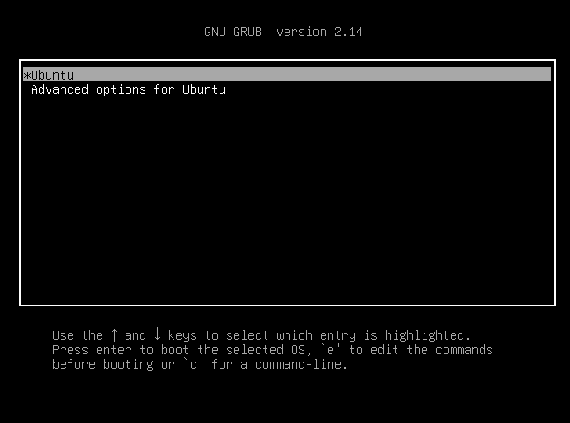
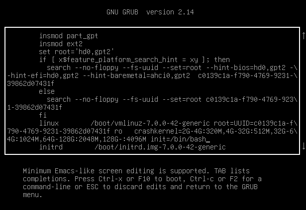
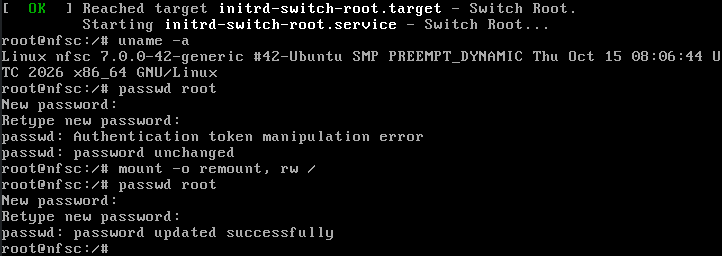
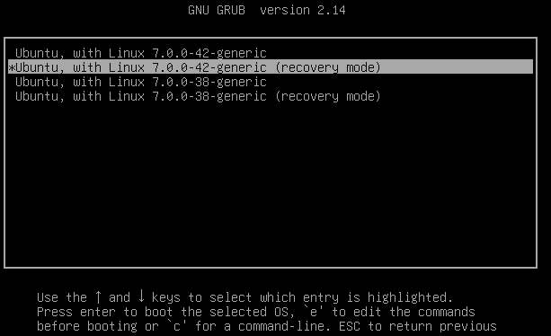
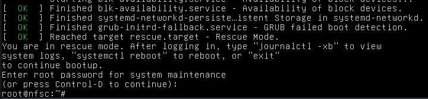
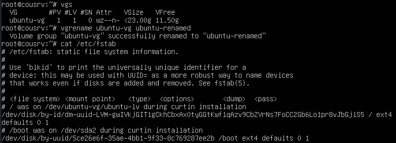
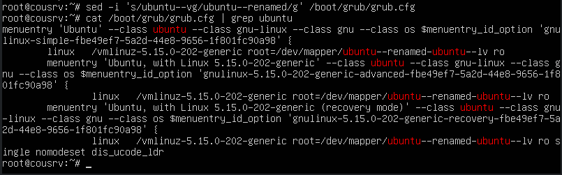
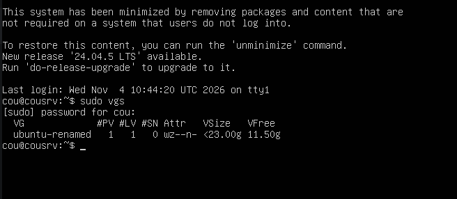

# Задание

1. Включить отображение меню Grub.
    
2. Попасть в систему без пароля несколькими способами.
    
3. Установить систему с LVM, после чего переименовать VG.

1:
внес правки в /etc/default/grub для его отображения:
```
root@nfsc:~# vi /etc/default/grub
root@nfsc:~# cat /etc/default/grub
# If you change this file or any /etc/default/grub.d/*.cfg file,
# run 'update-grub' afterwards to update /boot/grub/grub.cfg.
# For full documentation of the options in these files, see:
#   info -f grub -n 'Simple configuration'

GRUB_DEFAULT=0
#GRUB_TIMEOUT_STYLE=hidden
GRUB_TIMEOUT=30
```
обновил конфигурацию, перезагрузил:
```
root@nfsc:~# update-grub
Sourcing file `/etc/default/grub'
Sourcing file `/etc/default/grub.d/kdump-tools.cfg'
Generating grub configuration file ...
Found linux image: /boot/vmlinuz-7.0.0-42-generic
Found initrd image: /boot/initrd.img-7.0.0-42-generic
Found linux image: /boot/vmlinuz-7.0.0-38-generic
Found initrd image: /boot/initrd.img-7.0.0-38-generic
Found linux image: /boot/vmlinuz-7.0.0-30-generic
Found initrd image: /boot/initrd.img-7.0.0-30-generic
Warning: os-prober will not be executed to detect other bootable partitions.
Systems on them will not be added to the GRUB boot configuration.
Check GRUB_DISABLE_OS_PROBER documentation entry.
Adding boot menu entry for UEFI Firmware Settings ...
done
root@nfsc:~# reboot
```


меню grub теперь появляется при загрузке.



2:

жмем Е при выборе ядра в груб, добавляем init=/bin/bash и нажимаем сtrl-x:



после запуска bash пока еще ничего менять нельзя, надо перемонтировать корень в RW:



переход в рекавери



в первом способе я задал пароль рута (не зная его заранее), теперь захожу с ним в рекавери:




3:
переименовать VG, восстановить загрузку.
поменял имя VG, на всякий случай проверил fstab но там уже все по uuid-ам:




правлю grub.cfg:




после ребута все нормально:

